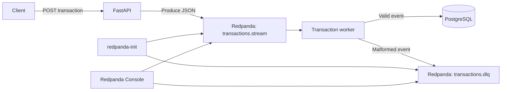

# Finance Stream Engine

Finance Stream Engine is a Python 3.12 transaction streaming project. A FastAPI service publishes transaction events to Redpanda, and a Kafka consumer worker validates and persists those events in PostgreSQL. Docker Compose runs the API, worker, database, broker, topic initialization job, and Redpanda Console.

## Architecture



The worker commits a message after successful database processing. Malformed messages are sent to `transactions.dlq` and then committed so they do not block the main stream.

## Compose Services

- `db`: PostgreSQL 14, exposed on host port `5432`.
- `db-init`: one-shot job that creates the SQLAlchemy tables after PostgreSQL is healthy.
- `redpanda`: Kafka-compatible event broker. Docker services connect to `redpanda:9092`; local processes connect through `localhost:19092`.
- `redpanda-init`: one-shot job that creates `transactions.stream` and `transactions.dlq`.
- `redpanda-console`: web UI at `http://localhost:8080`.
- `api`: FastAPI/Uvicorn at `http://localhost:8000`.
- `transaction-worker`: consumes `transactions.stream`, stores valid events in PostgreSQL, and routes malformed JSON to the DLQ.

## API

The API root is `GET /`. Interactive documentation is available at `http://localhost:8000/docs`.

All transaction endpoints require the `X-Client-Token` header.

- `POST /generate_mock_transaction`: generates a synthetic event and publishes it to `transactions.stream`.
- `POST /generate_transaction`: validates the submitted event against `TransactionEvent`, then publishes it to `transactions.stream`.

Example for submitting a transaction:

```bash
curl -X POST http://localhost:8000/generate_transaction \
    -H 'Content-Type: application/json' \
    -H 'X-Client-Token: your-token' \
    -d '{
        "transaction_id": "txn-001",
        "user_id": "user-001",
        "merchant_id": "merchant-001",
        "amount": 42.50,
        "status": "completed",
        "timestamp": "2026-10-13T12:00:00Z"
    }'
```

## Run with Docker Compose

Create a local `.env` with the required credentials and token, then start the stack:

```bash
docker compose up -d
```

Compose initializes the database and both Redpanda topics before starting dependent services. Check the services and topic list with:

```bash
docker compose ps
docker compose logs redpanda-init
docker compose exec redpanda rpk topic list -X brokers=redpanda:9092
```

Useful URLs:

- API: `http://localhost:8000/`
- API docs: `http://localhost:8000/docs`
- Redpanda Console: `http://localhost:8080`

## Environment Configuration

The `.env` file supplies these variables to Compose:

```env
X_CLIENT_TOKEN=your-token
POSTGRES_USER=postgres
POSTGRES_PASSWORD=postgres
POSTGRES_DB=finance_stream_engine
POSTGRES_HOST=db
KAFKA_BROKER=redpanda:9092
KAFKA_GROUP_ID=finance_stream_engine_group
```

Inside Compose, the API and worker use `db` and `redpanda` as service hostnames. The broker also exposes a local-development listener on port `19092`, which advertises `localhost:19092` to clients running outside Docker.

## Local Development from WSL

Keep PostgreSQL and Redpanda running in Compose, then run the API or worker directly from WSL with host-accessible addresses. Install project dependencies and run tests with:

```bash
uv sync
uv run pytest
```

Run the worker locally:

```bash
POSTGRES_HOST=localhost KAFKA_BROKER=localhost:19092 uv run python -m src.workers.transaction_worker
```

Run the API locally:

```bash
POSTGRES_HOST=localhost KAFKA_BROKER=localhost:19092 uv run uvicorn src.api.v1.app:app --reload
```

The environment assignments override the Compose-oriented hostnames from `.env` for that command only.

## Project Structure

```text
finance-stream-engine/
├── docker-compose.yml
├── pyproject.toml
├── README.md
├── src/
│   ├── api/v1/          # FastAPI app and routes
│   ├── database/        # SQLAlchemy engine, sessions, and initialization
│   ├── generator/       # Synthetic transaction generation
│   ├── models/          # Pydantic events and SQLAlchemy models
│   └── workers/         # Redpanda transaction consumer and DLQ handling
└── tests/               # API and generator tests
```

## Tech Stack

- Python 3.12 and uv
- FastAPI, Uvicorn, and Pydantic
- Confluent Kafka Python client
- Redpanda and Redpanda Console
- PostgreSQL and SQLAlchemy
- Pytest