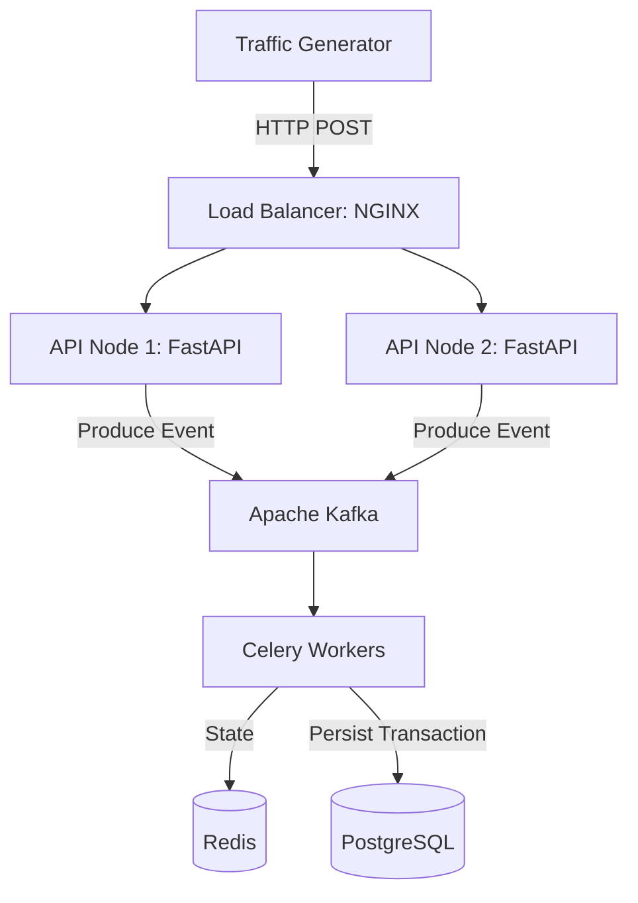

# Fintech Streaming and Processing Engine

A high-throughput, real-time financial transaction ingestion and processing pipeline designed to study distributed systems, event-driven architectures, asynchronous task execution, and backend infrastructure engineering.

## Architecture

The system simulates a high-concurrency payment gateway. Incoming transactions hit a load balancer, are ingested immediately by a FastAPI cluster, streamed through Apache Kafka, processed asynchronously via Celery workers, cached in Redis, and persisted in PostgreSQL.



## Project Structure

```text
finance-stream-engine/
├── .env
├── .python-version
├── .venv/
├── docker-compose.yml            # Infra services (PostgreSQL, Redis, Kafka, etc.)
├── pyproject.toml                # Python project config and dependencies
├── uv.lock
├── README.md                     # Project documentation and architecture spec
├── src/
│   ├── api/                      # FastAPI application and routing
│   ├── database/                 # Database-related utilities and configuration
│   ├── generator/                # Synthetic financial transaction generator
│   └── models/                   # Pydantic schemas and domain models
├── tests/
│   └── generator/                # Unit tests for the transaction generator
└── .pytest_cache/
```

## Tech Stack

- Language: Python 3.12+
- Validation: Pydantic
- API Framework: FastAPI / Uvicorn
- Event Streaming: Apache Kafka / Zookeeper
- Task Queue & Cache: Celery / Redis
- Database: PostgreSQL
- Load Balancing: NGINX
- Testing: Pytest

## Development Philosophy

This repository follows a strict Test-Driven Development (TDD) methodology. Every component, schema, endpoint, and worker must have corresponding unit or integration tests written before implementation.