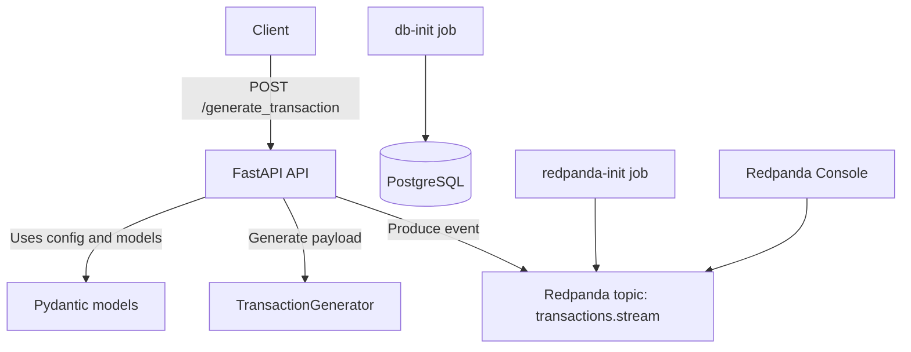

# Finance Stream Engine

Finance Stream Engine is a Python 3.12 project for generating synthetic financial transactions, exposing them through a FastAPI service, and publishing them to a Redpanda topic. The local stack is orchestrated with Docker Compose and includes PostgreSQL, Redpanda, Redpanda Console, and the API service.

## Current Architecture



## Services in Docker Compose

- `db`: PostgreSQL 14 database.
- `db-init`: one-shot initialization job that creates the SQLAlchemy schema.
- `redpanda`: event streaming broker.
- `redpanda-init`: one-shot initialization job that creates the `transactions.stream` topic.
- `redpanda-console`: web UI for browsing brokers, topics, and messages at `http://localhost:8080`.
- `api`: FastAPI application served by Uvicorn at `http://localhost:8000`.

## API Behavior

The main endpoint is `POST /generate_transaction`.

- Requires the `X-Client-Token` header.
- Generates a synthetic transaction using `TransactionGenerator`.
- Publishes the transaction JSON to the `transactions.stream` topic in Redpanda.
- Returns `202 Accepted` with the generated payload.

The API root endpoint is `GET /` and returns a welcome message.

## Project Structure

```text
finance-stream-engine/
├── docker-compose.yml
├── pyproject.toml
├── README.md
├── src/
│   ├── api/
│   │   └── v1/
│   │       ├── app.py
│   │       └── routes/
│   ├── database/
│   ├── generator/
│   └── models/
└── tests/
```

## Tech Stack

- Python 3.12
- FastAPI
- Uvicorn
- Pydantic
- SQLAlchemy
- PostgreSQL
- Redpanda
- Redpanda Console
- Confluent Kafka Python client
- Pytest

## Running the Stack

Start everything with Docker Compose:

```bash
docker compose up -d
```

Useful endpoints:

- API root: `http://localhost:8000/`
- API docs: `http://localhost:8000/docs`
- Redpanda Console: `http://localhost:8080`

## Environment Variables

The project expects an `.env` file with values like these:

```env
X_CLIENT_TOKEN=your-token
POSTGRES_USER=postgres
POSTGRES_PASSWORD=postgres
POSTGRES_DB=finance_stream_engine
POSTGRES_HOST=localhost
KAFKA_BROKER=localhost:9092
```

Inside Docker Compose, service-to-service communication uses internal hostnames such as `db` and `redpanda`. The Compose services override those host values where needed.

## Local Development

Install dependencies locally with `uv`:

```bash
uv sync
```

Run tests:

```bash
uv run pytest
```

Run the API outside Docker:

```bash
uv run uvicorn src.api.v1.app:app --reload
```